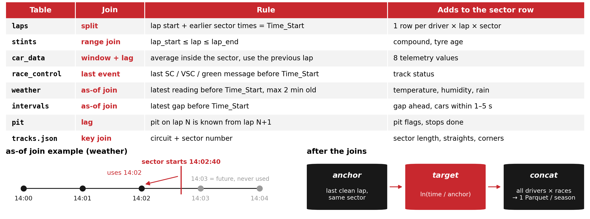
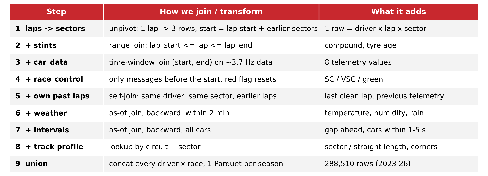
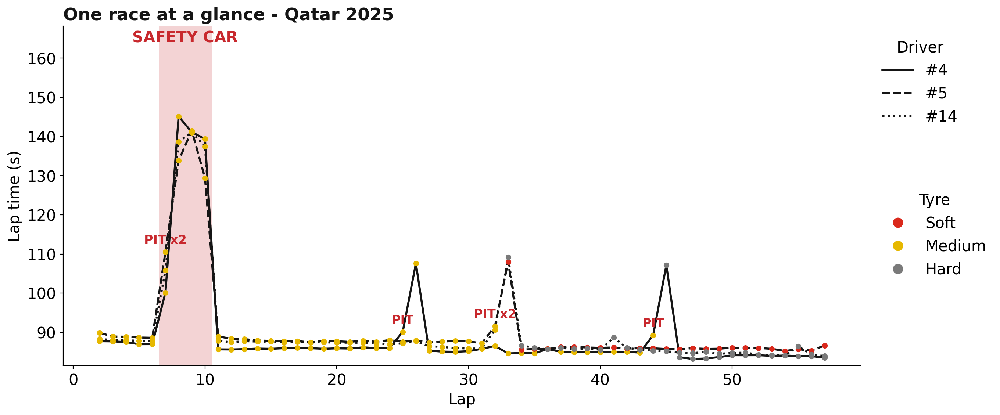
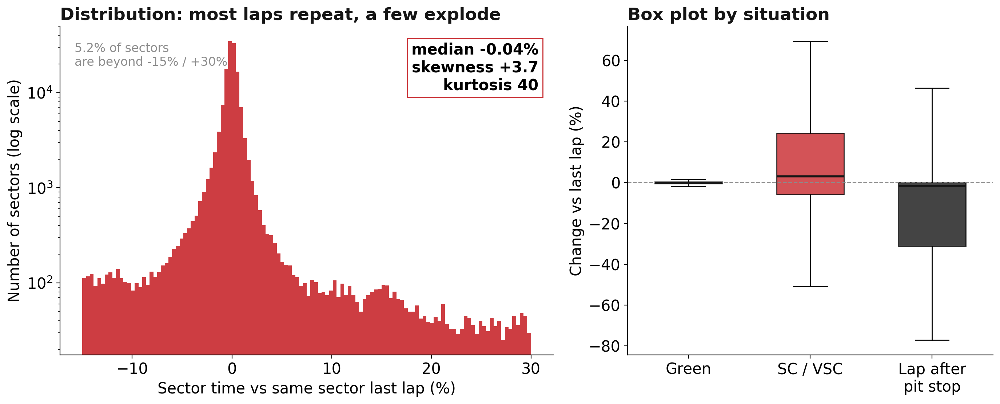
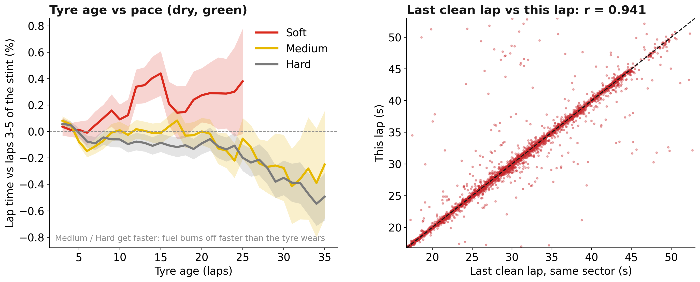
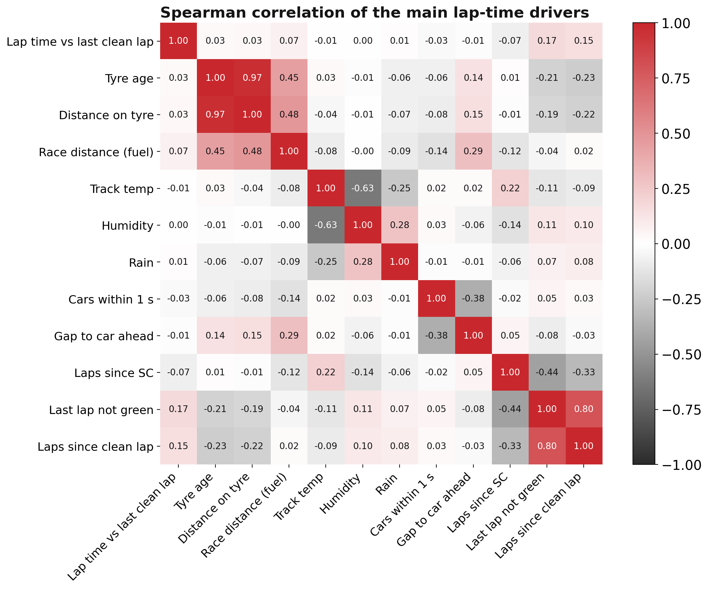
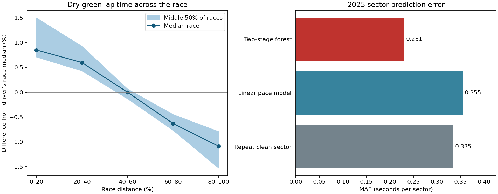
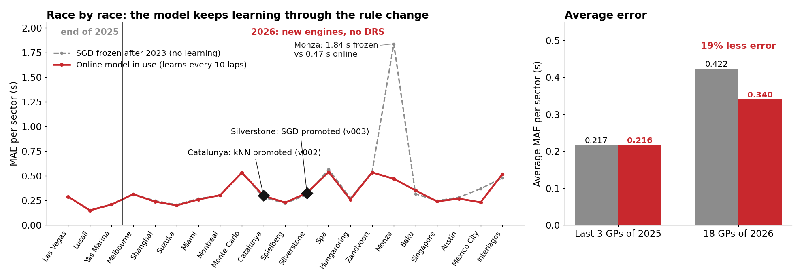

# Formula 1 Sector Duration Analysis

```{=html}
<p align="center">
```
`<strong>`{=html}Predicting the Next Sector Time in Formula 1 from
Point-in-Time OpenF1 Data`</strong>`{=html} `<br>`{=html}
`<em>`{=html}CSS 342 --- Data Science and Data Engineering`</em>`{=html}
```{=html}
</p>
```
```{=html}
<p align="center">
```
``{=html}
``{=html}
``{=html}
``{=html}
```{=html}
</p>
```
โครงงานนี้พัฒนา **Data Pipeline และระบบ Machine Learning
สำหรับพยากรณ์เวลาที่นักขับจะใช้ในเซกเตอร์ถัดไป** ของการแข่งขัน Formula 1
โดยใช้ข้อมูลจาก OpenF1 API
และยึดหลักสำคัญว่าโมเดลจะใช้ได้เฉพาะข้อมูลที่ทราบแล้วก่อนเซกเตอร์เป้าหมายเริ่มต้นเท่านั้น
(point-in-time correctness) เพื่อป้องกันข้อมูลอนาคตรั่วไหลเข้าโมเดล (data
leakage)

> **ผลลัพธ์หลัก:** Two-Stage Forest v3 ทำ MAE ได้ **0.2305 วินาทีต่อเซกเตอร์**
> และ (R\^2 = 0.9927) บนฤดูกาล 2025 ซึ่งแยกไว้เป็นชุดทดสอบที่ไม่ถูกใช้ฝึกโมเดล
> โดยดีกว่า baseline ที่นำเวลาเซกเตอร์สะอาดล่าสุดมาใช้ซ้ำ 31.2%

------------------------------------------------------------------------

## สารบัญ

-   [1. ภาพรวมโครงงาน](#1-ภาพรวมโครงงาน)
-   [2. คำถามและวัตถุประสงค์](#2-คำถามและวัตถุประสงค์)
-   [3. ข้อมูลและแหล่งข้อมูล](#3-ข้อมูลและแหล่งข้อมูล)
-   [4. Data Engineering Pipeline](#4-data-engineering-pipeline)
-   [5. Data Quality และ Data
    Cleaning](#5-data-quality-และ-data-cleaning)
-   [6. Feature Engineering และ Point-in-Time
    Correctness](#6-feature-engineering-และ-point-in-time-correctness)
-   [7. Exploratory Data Analysis](#7-exploratory-data-analysis)
-   [8. Statistical Analysis](#8-statistical-analysis)
-   [9. Machine Learning: Two-Stage Forest
    v3](#9-machine-learning-two-stage-forest-v3)
-   [10. การทดลองและพัฒนารุ่นโมเดล](#10-การทดลองและพัฒนารุ่นโมเดล)
-   [11. Online Learning และ Concept
    Drift](#11-online-learning-และ-concept-drift)
-   [12. ผลลัพธ์และการประเมิน](#12-ผลลัพธ์และการประเมิน)
-   [13. Error Analysis](#13-error-analysis)
-   [14. ข้อจำกัด](#14-ข้อจำกัด)
-   [15. การติดตั้งและเริ่มใช้งาน](#15-การติดตั้งและเริ่มใช้งาน)
-   [16. โครงสร้าง Repository](#16-โครงสร้าง-repository)
-   [17. เทคโนโลยีที่ใช้](#17-เทคโนโลยีที่ใช้)
-   [18. เอกสารและแหล่งอ้างอิง](#18-เอกสารและแหล่งอ้างอิง)

------------------------------------------------------------------------

## 1. ภาพรวมโครงงาน

การแข่งขัน F1 หนึ่งรอบสนามถูกแบ่งออกเป็น 3 เซกเตอร์ และแต่ละเซกเตอร์ใช้เวลาประมาณ
20--40 วินาที เวลาที่ใช้ในเซกเตอร์ถัดไปไม่ได้ขึ้นอยู่กับความเร็วของรถเพียงอย่างเดียว
แต่ได้รับอิทธิพลจากหลายปัจจัย เช่น

-   **Tyre:** ชนิดยางและอายุยาง (Soft, Medium, Hard, Intermediate และ Wet)
-   **Track Status:** ธงเขียว, Safety Car (SC), Virtual Safety Car (VSC)
    และช่วงเปลี่ยนผ่าน
-   **Weather:** อุณหภูมิแทร็ก อุณหภูมิอากาศ ความชื้น ความกดอากาศ และสัญญาณฝน
-   **Traffic:** ระยะห่างจากรถคันหน้าและจำนวนรถที่อยู่ใกล้
-   **Pit Stop:** การเข้าพิทและสถานะรอบก่อน/หลังพิท
-   **Track Geometry:** ความยาวเซกเตอร์ ความยาวทางตรง และลักษณะของโค้ง
-   **Race Progress:** รอบการแข่งขัน ระยะทางสะสม
    และแนวโน้มความเร็วในรอบก่อนหน้า

โจทย์จึงไม่ใช่แค่การนำเวลาเดิมมาทำนายซ้ำ
แต่เป็นการสร้างชุดข้อมูลที่รวมข้อมูลหลายแหล่งและหลายความถี่ให้ตรงกับเวลาที่ใช้ทำนาย
จากนั้นศึกษาว่าปัจจัยใดสัมพันธ์กับเวลา และพัฒนาโมเดลที่ปรับตัวได้เมื่อสภาพการแข่งขันเปลี่ยนไป

### ขอบเขตข้อมูล

  ฤดูกาล       จำนวนสนาม   จำนวนแถวก่อนทำความสะอาด การใช้งาน
  --------- ----------- ------------------------ --------------------------------
  2023               22                   71,395 Training / Online warm-up
  2024               24                   77,918 Training / Online stream
  2025               24                   76,952 Holdout test สำหรับ Batch ML
  2026               18                   62,245 ทดสอบ Concept Drift จากกติกาใหม่
  **รวม**        **88**              **288,510** 2023--2025 มี 70 สนาม

หลังทำความสะอาดข้อมูลสำหรับการทดลอง Batch ML เหลือข้อมูลปี 2023--2025 จำนวน
**208,627 แถว** แบ่งเป็น Training 2023--2024 จำนวน **138,217 แถว** และ
Test 2025 จำนวน **70,410 แถว** ส่วนปี 2026 ใช้ในชุดทดลอง Concept Drift
แยกต่างหาก

**หน่วยข้อมูลหลัก:** 1 แถวแทน นักขับ 1 คน × รอบ 1 รอบ × เซกเตอร์ 1 เซกเตอร์

------------------------------------------------------------------------

## 2. คำถามและวัตถุประสงค์

โครงงานตั้งคำถามหลัก 3 ข้อ

1.  **อะไรทำให้รถเร็วขึ้นหรือช้าลง?** ศึกษาผลของยาง อายุยาง Safety Car, VSC
    และการเข้าพิท รวมถึงทดสอบสมมติฐานทางสถิติ
2.  **ทำนายเวลาเซกเตอร์ถัดไปได้แม่นแค่ไหน?** ประเมิน MAE บนฤดูกาล 2025
    ที่ไม่เคยใช้ฝึก พร้อมเปรียบเทียบกับ baseline และโมเดลอื่น
3.  **โมเดลเรียนรู้ระหว่างการแข่งขันได้หรือไม่?** เปรียบเทียบ Online Learning
    กับโมเดลที่หยุดเรียนรู้ และศึกษาความสามารถในการรับมือการเปลี่ยนกติกาปี 2026

เป้าหมายทางวิศวกรรมข้อมูลคือสร้าง Pipeline ที่ดึงข้อมูลซ้ำได้ ทนต่อ API rate limit
และการเชื่อมต่อขัดข้อง ตรวจสอบคุณภาพข้อมูล และสร้าง Analytical Dataset
ที่ถูกต้องตามเวลา

------------------------------------------------------------------------

## 3. ข้อมูลและแหล่งข้อมูล

ข้อมูลหลักมาจาก OpenF1 REST API (`https://api.openf1.org/v1`) โดยใช้ข้อมูลหลาย
endpoint ซึ่งมีความถี่ไม่เท่ากัน

  --------------------------------------------------------------------------
  แหล่งข้อมูล                ข้อมูลที่นำมาใช้             จุดประสงค์
  ----------------------- ----------------------- --------------------------
  `sessions`, `meetings`  รายการแข่งขัน สนาม วันที่    ระบุการแข่งขันหลัก (Race)
                          และ session key         

  `laps`                  เวลาเซกเตอร์ เวลาเริ่มรอบ  สร้าง target
                          speed trap และ pit-out  และประวัติความเร็ว

  `stints`                ชนิดยาง อายุยาง           สร้างฟีเจอร์ยาง
                          และช่วงรอบของ stint      

  `pit`                   เวลาและรอบที่เข้าพิท        สร้างบริบทการเข้าพิท

  `car_data`              ความเร็ว คันเร่ง เบรก DRS  สร้าง telemetry 8 ช่อง
                          และเกียร์                 

  `location`              พิกัด x/y ของรถ           สร้างเส้นทางและเรขาคณิตสนาม

  `weather`               อุณหภูมิ ความชื้น            สร้างบริบทสภาพอากาศ
                          ความกดอากาศ และฝน       

  `race_control`          ข้อความธง SC, VSC        ระบุสถานะสนาม
                          และธงแดง                

  `intervals`             ระยะห่างจากรถคันหน้า/ผู้นำ   สร้างฟีเจอร์การจราจร

  `drivers`               ชื่อ หมายเลข และทีม        ใช้กำกับข้อมูล

  `track-atlas`           ผังสนาม ตำแหน่งเซกเตอร์    สร้างฟีเจอร์เรขาคณิตสนาม
                          และช่วงโค้ง               

  Open-Meteo archive      ฝนรายชั่วโมงจาก ERA5      ใช้เฉพาะการทดลองด้านฝน
  --------------------------------------------------------------------------

### ความถี่ของข้อมูล

-   `laps` และ `stints` เป็นข้อมูลระดับรอบหรือช่วง stint
-   `car_data` และ `location` มีความถี่ประมาณ 3.7 Hz
-   `weather` อัปเดตประมาณทุก 1 นาที
-   `race_control` เป็นข้อมูลตามเหตุการณ์
-   `intervals` เป็นข้อมูลระยะห่างที่มีการอัปเดตตามเวลา

ความถี่ที่ต่างกันทำให้การรวมข้อมูลต้องใช้ timestamp และกฎ join ที่เหมาะสม
ไม่สามารถนำข้อมูลทุกตารางมา merge ด้วย key เดียวกันได้

### ข้อจำกัดของแหล่งข้อมูล

-   OpenF1 weather ให้สัญญาณฝนแบบ 0/1
    ไม่ได้บอกความแรงของฝนหรือความเปียกของผิวแทร็กอย่างละเอียด
-   ไม่มีข้อมูลปริมาณน้ำมันในถัง อุณหภูมิยาง และการตั้งค่ารถ
-   Telemetry ประมาณ 3.7 Hz อาจไม่ละเอียดพอสำหรับรายละเอียดการขับในโค้งสั้น ๆ
-   ข้อความ Race Control บางเหตุการณ์ไม่ครบ จึงต้องตรวจสอบและซ่อมสถานะสนาม
-   ปี 2026 มีข้อมูลเพียง 18 จาก 22 สนามตามขอบเขตของชุดข้อมูล และ Monaco 2026
    ต้องใช้เส้นทางสนามจากปี 2025 แทนในส่วนที่ telemetry ตำแหน่งขาดหาย

------------------------------------------------------------------------

## 4. Data Engineering Pipeline

Pipeline เขียนด้วย Python และจัดโครงสร้างเป็นแพ็กเกจ `f1pit` โดยไม่ใช้
Orchestrator ภายนอก เนื่องจากงานหลักเป็น Batch Processing รายฤดูกาลและมี Disk
Cache สำหรับหยุดแล้วทำต่อได้



### ลำดับการทำงาน

1.  **Ingest** --- ดึงข้อมูลจาก OpenF1 ผ่านฟังก์ชันกลาง `fetch()`
2.  **Cache** --- เก็บผลตอบกลับทั้งใน Memory และ Disk เพื่อลดการเรียก API ซ้ำ
3.  **Quality** --- ตรวจ Missing, Duplicate, Invalid, Inconsistent และ
    Outlier พร้อมแก้ปัญหาสถานะ SC ที่ค้างหลังธงแดง
4.  **Transform** --- แปลงเวลา สร้าง sector-level rows และคำนวณ
    point-in-time features
5.  **Store** --- บันทึกข้อมูลที่ประมวลผลแล้วเป็น Parquet แยกตามฤดูกาล
    พร้อมบันทึกโมเดลและผลทดลอง
6.  **Serve / Stream** --- ใช้โมเดลทำนายเซกเตอร์ถัดไป และทดลองอัปเดตโมเดลทุก
    10 รอบ



### การดึงข้อมูลให้ทนทาน

ทุกคำขอ OpenF1 ผ่าน `fetch()` ซึ่งทำหน้าที่หลักดังนี้

-   ใช้ `requests.Session` ร่วมกันเพื่อนำ HTTP connection กลับมาใช้ซ้ำ
-   Retry พร้อม Exponential Backoff เมื่อพบ HTTP 429 หรือ 5xx
-   ใช้ Cache สองชั้น (Memory + Disk) เพื่อให้การรันซ้ำไม่ต้องดาวน์โหลดข้อมูลเดิม
-   เมื่อ endpoint ตอบ 404 ให้คืน DataFrame
    ว่างแทนการทำให้การสร้างข้อมูลทั้งฤดูกาลล้มเหลว
-   เตรียม Cache ล่วงหน้าแบบขนานเพื่อลดเวลารอในขั้นสร้าง Dataset
-   แปลง timestamp เป็น `datetime64[ns, UTC]` ผ่าน `to_utc()`
    เพื่อป้องกันปัญหาความละเอียด datetime ไม่ตรงกัน

### การจัดเก็บข้อมูล

  -------------------------------------------------------------------------
  ประเภท                  รูปแบบ                   เนื้อหา
  ----------------------- ----------------------- -------------------------
  Raw API cache           Pickle                  คำตอบ API แยกตาม endpoint
                                                  และ parameters

  Track context           Pickle                  สนามและข้อมูลโค้งที่จัดกลุ่มแล้ว

  Analytical Dataset      Parquet                 ตารางระดับเซกเตอร์
                                                  แยกไฟล์ตามฤดูกาล

  Dataset พร้อม Outcome    Parquet                 เพิ่ม telemetry
                                                  ของเซกเตอร์ปัจจุบัน ใช้เป็น
                                                  target ของ Stage 1 เท่านั้น

  Batch models            Pickle + JSON           Stage 1, Stage 2,
                                                  metadata และผลประเมิน

  Online predictions      Parquet + JSON          คำทำนายและประวัติ lineage
                                                  ของโมเดล

  Experiment results      JSON                    MAE, Feature Importance,
                                                  ผลแยกตามสภาวะ และ Drift
                                                  Lab
  -------------------------------------------------------------------------

**เหตุผลที่เลือก Parquet:** เป็น Columnar Format บีบอัดได้ดี
อ่านเฉพาะคอลัมน์ที่ต้องการได้ และเก็บชนิดข้อมูลรวมถึง datetime ที่มี timezone
ได้เหมาะสมกว่า CSV สำหรับงานนี้

------------------------------------------------------------------------

## 5. Data Quality และ Data Cleaning

ตรวจสอบคุณภาพข้อมูล 5 ด้านก่อนนำไปวิเคราะห์หรือฝึกโมเดล

  ------------------------------------------------------------------------------------------------
  มิติ                      วิธีตรวจสอบ                              ตัวอย่างการจัดการ
  ----------------------- -------------------------------------- ---------------------------------
  Missing Values          ตรวจสัดส่วนค่าว่างของทุกคอลัมน์               เติมค่าตัวเลขด้วย median พร้อม missing
                                                                 indicator; เติมค่ากลุ่มด้วยค่าที่พบบ่อย

  Duplicate Records       ตรวจ key                               ตรวจพบ 0 duplicate ในชุดข้อมูล
                          `(Session_Key, Driver, Lap, Sector)`   2023--2025
                          และแถวซ้ำ                               

  Invalid Values          ตรวจช่วงค่าทางกายภาพ เช่น Duration,       ตรวจค่าที่อยู่นอกช่วงและประเมินผลกระทบ
                          Speed, Humidity                        

  Inconsistent Data       ตรวจความหมายของข้อมูลให้ตรงกันข้ามฤดูกาล     ตัด `Num_Corner_*`
                                                                 ที่จัดกลุ่มใหม่ไม่สอดคล้องกันในแต่ละปี

  Outliers                ตรวจด้วย IQR และ MAD                    ใช้กฎ MAD
                                                                 คัดรอบที่ช้าผิดปกติตามเงื่อนไขของชุดข้อมูล
  ------------------------------------------------------------------------------------------------

### กรณีสำคัญ: Safety Car ค้างหลังธงแดง

พบการแข่งขันปี 2023 ที่แถวจำนวนมากถูกระบุเป็น SC/VSC
ทั้งที่รถกลับมาวิ่งด้วยความเร็วปกติแล้ว สาเหตุคือบางลำดับเหตุการณ์มี SC/VSC
ตามด้วยธงแดงและ Standing Restart โดยไม่มีข้อความ `SAFETY CAR IN THIS LAP`
ทำให้ parser เดิมไม่ทราบว่า SC สิ้นสุดแล้ว

แนวทางแก้ไขคือให้เหตุการณ์ `RED FLAG` รีเซ็ตสถานะสนามในตัวแปลง Race Control
และใช้ `repair_track_status()` ซ่อมข้อมูลเดิมที่สร้างไปแล้ว
ปัญหานี้ส่งผลต่อการสร้างฟีเจอร์ SC และผลโมเดลโดยตรง

### หลักการทำความสะอาด

-   แปลงเวลาเป็น UTC และเรียงข้อมูลตามลำดับเวลา
-   ตัดรอบแรกของนักขับ เพราะไม่มีประวัติรอบก่อนหน้าให้ใช้ทำนาย
-   ตัดแถวที่ค่าจำเป็นไม่ถูกต้อง เช่น `Tyre_Age`, `Prev_Duration`
    หรือความเร็วเฉลี่ยในโค้ง
-   เก็บเฉพาะ Sector 1, 2 และ 3
-   ตัดรอบที่เป็น Outlier ตามกฎ MAD ที่กำหนด
-   ทำค่ากลุ่ม `Tyre` และ `Track_Status` ให้เป็นมาตรฐาน

------------------------------------------------------------------------

## 6. Feature Engineering และ Point-in-Time Correctness

หัวใจของโครงงานคือ **ทุกฟีเจอร์ต้องเป็นข้อมูลที่ทราบได้ ณ เวลา `Time_Start`
ของเซกเตอร์ที่ต้องการทำนาย** ห้ามใช้ข้อมูลจากภายในเซกเตอร์ปัจจุบันหรือจากอนาคต

### 6.1 การสร้างแถวระดับเซกเตอร์

ข้อมูล `laps` มีเวลาเซกเตอร์ 1, 2 และ 3 อยู่ในแถวเดียว จึงแปลงจาก Wide Format
เป็น Long Format (Unpivot) เพื่อให้ 1 รอบกลายเป็น 3 แถว

ตัวอย่างโครงสร้าง:

  Session_Key     Driver   Lap   Sector        Duration
  ------------- -------- ----- -------- ---------------
  11361               63    10        1   เวลาเซกเตอร์ 1
  11361               63    10        2   เวลาเซกเตอร์ 2
  11361               63    10        3   เวลาเซกเตอร์ 3

### 6.2 กฎการ Join ข้อมูล

  ------------------------------------------------------------------------------------
  ตาราง                   วิธี Join                 กฎสำคัญ
  ----------------------- ----------------------- ------------------------------------
  `laps`                  Unpivot                 สร้าง 3 แถวต่อรอบ และคำนวณ
                                                  `Time_Start`

  `stints`                Range Join              `lap_start <= lap <= lap_end`

  `car_data`              Time Window + Lag       Aggregate telemetry ในช่วงเซกเตอร์
                                                  แต่ใช้ค่าจากรอบก่อนเป็น Feature

  `race_control`          Last Event              ใช้เหตุการณ์ล่าสุดก่อน `Time_Start`

  Previous Lap            Self Join               จับคู่คนขับและเซกเตอร์เดียวกันในรอบก่อนหน้า

  `weather`               Backward As-of Join     ใช้ค่าล่าสุดก่อน `Time_Start`
                                                  และต้องมีอายุไม่เกิน 2 นาที

  `intervals`             Backward As-of Join     ใช้ระยะห่างล่าสุดก่อน `Time_Start`

  `pit`                   Lag                     การเข้าพิทรอบ N
                                                  จะนำมาใช้เป็นข้อมูลที่รู้ได้ตั้งแต่รอบ N+1

  Track Geometry          Key Join                จับคู่สนามและหมายเลขเซกเตอร์

  All Drivers             Concat                  รวมข้อมูลทุกนักขับและทุกการแข่งขัน
  ------------------------------------------------------------------------------------

การใช้ Backward As-of Join มีความสำคัญมาก ตัวอย่างเช่น หากเซกเตอร์เริ่มเวลา
14:02:40 จะใช้ Weather Observation เวลา 14:02 แต่จะไม่ใช้ข้อมูลเวลา 14:03
เพราะเป็นข้อมูลที่เกิดหลังเวลาเริ่มเซกเตอร์


### 6.3 Representative Anchor: จุดอ้างอิงรอบสะอาดล่าสุด

การใช้ `Prev_Duration` หรือเวลาเซกเตอร์ของรอบก่อนหน้าเป็นจุดอ้างอิงมีปัญหา
หากรอบก่อนหน้าเป็นรอบ SC, VSC, รอบเข้าพิท หรือรอบที่ผิดปกติ
โมเดลจะต้องเรียนรู้การย้อนกลับจากความผิดปกตินั้น
แทนที่จะเรียนรู้การเปลี่ยนแปลงของความเร็วตามสภาพการแข่งขันจริง

จึงสร้าง `Rep_Prev_Duration` หรือ Representative Anchor
เป็นเวลาเซกเตอร์เดียวกันของ **รอบตัวแทนล่าสุด** ซึ่งต้องผ่านเงื่อนไขหลัก:

-   เป็นรอบ GREEN
-   เวลาไม่เกิน 1.12 เท่าของ Median จาก 5 รอบเขียวก่อนหน้า
-   ไม่ใช่รอบที่ผิดปกติหรือได้รับผลกระทบจากเหตุการณ์พิเศษ

นอกจากนี้ยังสร้าง `Anchor_Age` เพื่อบอกว่าจุดอ้างอิงนี้เก่ากี่รอบ และมี missing
indicator เมื่อยังไม่มีรอบตัวแทน

### 6.4 กลุ่ม Feature สำคัญ

  ----------------------------------------------------------------------------------
  กลุ่ม                     ตัวแปรตัวอย่าง                 ใช้แทนอะไร
  ----------------------- --------------------------- ------------------------------
  Pace History            `Prev_Duration`,            ความเร็วและประวัติการขับ
                          `Clean_Pace`,               
                          `Best_Duration_So_Far`      

  Representative Anchor   `Rep_Prev_Duration`,        ความเร็วอ้างอิงจากรอบสะอาด
                          `Rep_Best_Duration`,        
                          `Anchor_Age`                

  Tyre                    `Tyre`, `Tyre_Age_Total`,   ชนิดและอายุยาง
                          `Tyre_Age_<compound>`       

  Track Status            `Track_Status`,             สถานะสนามและเหตุการณ์ก่อนหน้า
                          `Laps_Since_SC`,            
                          `Prev_Lap_NonGreen`         

  Pit                     `Prev_Lap_Pitted`,          ประวัติการเข้าพิท
                          `Pit_Stops_Done`            

  Weather                 `Track_Temperature`,        สภาพอากาศ
                          `Air_Temperature`,          
                          `Humidity`, `Pressure`,     
                          `Rainfall`                  

  Traffic                 `Interval_Ahead`,           การจราจรรอบรถ
                          `Traffic_Within_1s/2s/5s`   

  Telemetry               `Prev_*`, `Pred_*`          รูปแบบการขับจากรอบก่อนและค่าที่
                                                      Stage 1 คาดการณ์

  Track Geometry          `Total_Sector_Length`,      ลักษณะทางตรงและความยาวเซกเตอร์
                          `Total_Straight_Length`     

  Race Progress           `Lap`,                      ระยะการแข่งขันและระยะทางสะสม
                          `Total_Distance_Driven`,    
                          `Distance_On_Tyre`          

  Rolling Features        `*_roll5_mean`,             ค่าเฉลี่ยและแนวโน้มใน 5 รอบล่าสุด
                          `*_roll5_slope`             
  ----------------------------------------------------------------------------------

### 6.5 Relative Pace และ Target Transformation

เวลาเซกเตอร์มีสเกลต่างกันมากตามสนาม เช่น
สนามที่มีเซกเตอร์ยาวจะใช้เวลามากกว่าสนามที่มีเซกเตอร์สั้น
การทำนายเวลาเป็นวินาทีโดยตรงจึงทำให้โมเดลต้องเรียนรู้สเกลของทุกสนามใหม่

แนวทางสุดท้ายจึงเปลี่ยน Target เป็นอัตราส่วนเทียบ Representative Anchor:

\[ D =
`\ln`{=tex}`\left`{=tex}(`\frac{Duration}{Rep\_Prev\_Duration}`{=tex}`\right`{=tex})
\]

เมื่อโมเดลทำนาย (D) แล้ว แปลงกลับเป็นวินาทีด้วย:

\[ `\widehat{Duration}`{=tex} = Rep_Prev_Duration
`\times `{=tex}e\^{`\widehat{D}`{=tex}} \]

ฟีเจอร์ด้านความเร็วที่เป็นจุดอ้างอิงอื่น ๆ ก็ถูกแปลงเป็น Relative Pace เช่นกัน:

\[ Rel_X =
`\ln`{=tex}`\left`{=tex}(`\frac{X}{Rep\_Prev\_Duration}`{=tex}`\right`{=tex})
\]

วิธีนี้ทำให้โมเดลเรียนรู้การเปลี่ยนแปลงของความเร็วเมื่อเทียบกับจุดอ้างอิง
แทนที่จะเรียนรู้เวลาแบบ absolute ของทุกสนาม

### 6.6 การพิสูจน์ว่าไม่มี Data Leakage

ใช้การทดสอบแบบตัดข้อมูลอนาคตออก แล้วคำนวณฟีเจอร์ใหม่อีกครั้ง หากฟีเจอร์ ณ รอบ L
เปลี่ยนไป แสดงว่าอาจมีการใช้ข้อมูลอนาคตโดยไม่ตั้งใจ

การตรวจสอบครอบคลุม **648 กรณี** และไม่พบกรณีที่ค่าฟีเจอร์เปลี่ยนแปลง (0 กรณี)
ตามการทดสอบในรายงาน

------------------------------------------------------------------------

## 7. Exploratory Data Analysis

EDA ใช้เพื่อทำความเข้าใจรูปแบบของข้อมูล ตรวจสอบการกระจายตัว ความสัมพันธ์
และหาแนวทางออกแบบฟีเจอร์ก่อนสร้างโมเดล

### 7.1 Race Overview

กราฟตัวอย่างการแข่งขันแสดงเวลาต่อรอบของนักขับหลายคน พร้อมช่วง Safety Car
และการเข้าพิท ทำให้เห็นว่าเวลาส่วนใหญ่ในช่วงธงเขียวเกาะกลุ่มกัน
แต่จะเกิดการกระโดดของเวลาเมื่อมีเหตุการณ์พิเศษ



**Insight:** Safety Car สามารถทำให้เวลาต่อรอบเพิ่มขึ้นประมาณ 55 วินาที
ขณะที่รอบที่เข้าพิทอาจเพิ่มเวลาประมาณ 20 วินาทีในรอบนั้น
เหตุการณ์เหล่านี้จึงเป็นแหล่งความคลาดเคลื่อนสำคัญของการพยากรณ์

### 7.2 Distribution และ Outlier



ค่าการเปลี่ยนแปลงของเวลาเซกเตอร์เมื่อเทียบกับรอบก่อนหน้ามีลักษณะดังนี้:

  สถิติ                                  ค่า
  ------------------------------ --------
  Median                           -0.04%
  Skewness                           +3.7
  Kurtosis                             40
  สัดส่วนที่เปลี่ยนเกิน -15% หรือ +30%       5.2%

ข้อมูลมีการกระจุกตัวใกล้ 0% แต่มีหางด้านขวายาวและมีค่าผิดปกติจำนวนหนึ่ง
เมื่อแยกตามสถานการณ์พบว่ารอบ SC/VSC ช้าลงได้มาก ขณะที่รอบหลังพิทหรือหลัง SC
อาจเร็วขึ้นมากเมื่อเทียบกับรอบก่อนหน้าที่ช้าผิดปกติ

**Insight:**
การใช้เวลารอบก่อนหน้าเป็นจุดอ้างอิงโดยตรงอาจทำให้โมเดลเรียนรู้การย้อนกลับจากความผิดปกติของรอบก่อน
จึงเป็นเหตุผลสำคัญที่เปลี่ยนมาใช้ Representative Anchor

### 7.3 Bivariate Analysis



ผลการสำรวจพบว่า:

-   Soft มีแนวโน้มช้าลงเมื่ออายุยางเพิ่มขึ้น
-   Medium และ Hard ในข้อมูลดิบกลับมีแนวโน้มเร็วขึ้นในบางช่วง
    ซึ่งอาจเกิดจากน้ำมันที่ลดลงและ Track Evolution
-   `Rep_Prev_Duration` มีความสัมพันธ์กับเวลาเซกเตอร์ปัจจุบันสูง โดย Pearson
    correlation ประมาณ **0.941**

**Insight:** รอบสะอาดล่าสุดอธิบายเวลาเซกเตอร์ปัจจุบันได้เป็นส่วนใหญ่
โมเดลจึงควรใช้รอบดังกล่าวเป็นจุดเริ่มต้น แล้วทำนายเฉพาะการเปลี่ยนแปลง

### 7.4 Multivariate Correlation



ไม่พบตัวแปรเดี่ยวที่มีความสัมพันธ์กับการเปลี่ยนแปลงเวลาเทียบ Anchor อย่างเด่นชัด
(ค่าสหสัมพันธ์ส่วนใหญ่มีค่าสัมบูรณ์ต่ำกว่า 0.2)
แสดงว่าความเร็วเกิดจากหลายปัจจัยที่ทำงานร่วมกัน

คู่ตัวแปรที่ซ้ำซ้อน เช่น อายุยางกับระยะทางบนยางมีความสัมพันธ์สูงประมาณ 0.97
จึงเลือกเก็บตัวแทนเพียงบางตัวเพื่อลดความซ้ำซ้อน

### 7.5 Race Progress และ Track Difficulty

การวิเคราะห์ปี 2025 เฉพาะรอบแห้งและธงเขียวพบว่า เวลาต่อรอบเร็วขึ้นประมาณ **1.9%
จากต้นจนจบการแข่งขัน** ซึ่งอาจเกี่ยวข้องกับน้ำมันที่ลดลงและ Track Evolution

นอกจากนี้ความยากในการทำนายต่างกันตามสนาม เช่น Spa
มีส่วนเบี่ยงเบนมาตรฐานของเวลาอยู่ที่ประมาณ 11.07 วินาที ขณะที่ Imola อยู่ที่ประมาณ 1.95
วินาที แสดงให้เห็นว่าความแปรปรวนของสนามและสภาพอากาศส่งผลต่อความยากของโมเดล


------------------------------------------------------------------------

## 8. Statistical Analysis

การทดสอบทางสถิติตอบคำถามว่า ปัจจัยใดสัมพันธ์กับความเร็วของรถ
โดยเลือกวิธีทดสอบให้เหมาะกับชนิดข้อมูลและโครงสร้างของการเปรียบเทียบ

### 8.1 Medium ใหม่ เทียบกับ Hard เก่าที่ Monza 2026

**คำถาม:** รถที่ใช้ Medium ใหม่เร็วกว่า Hard เก่าหรือไม่

-   ใช้ข้อมูล Italian Grand Prix 2026 ที่ Monza
-   เปรียบเทียบ Mercedes สองคันในรอบเดียวกัน ตั้งแต่รอบ 30--53 รวม 24 คู่
-   ตัดรอบเข้าพิทและรอบหลังออกพิทออกจากการเปรียบเทียบ
-   ใช้ Paired t-test แบบทางเดียว โดยกำหนด (`\alpha `{=tex}= 0.01)

ผลการทดสอบ:

  รายการ                                                           ผล
  ----------------------------------- -------------------------------
  ความต่างเฉลี่ย (Russell − Antonelli)                    0.757 วินาที/รอบ
  จำนวนรอบที่ Russell ช้ากว่า                               22 จาก 24 รอบ
  t-statistic                                                    6.91
  p-value (one-tailed)                  (2.4 `\times 10`{=tex}\^{-7})
  95% CI                                          0.53--0.98 วินาที/รอบ

ผลมีนัยสำคัญทางสถิติที่ระดับ 0.01 อย่างไรก็ตาม
ไม่สามารถสรุปว่าเกิดจากชนิดยางเพียงอย่างเดียว เพราะนักขับ อายุยาง
และชนิดยางแตกต่างกันพร้อมกัน จึงควรตีความเป็นความแตกต่างที่สังเกตได้ในกรณีศึกษานี้
ไม่ใช่ผลเชิงเหตุของยางล้วน ๆ

### 8.2 อัตราการเสื่อมของยาง Soft, Medium และ Hard

**คำถาม:** ยางทั้งสามชนิดเสื่อมด้วยอัตราเดียวกันหรือไม่

ใช้ข้อมูลปี 2024--2025 เฉพาะ stint ที่แห้ง ธงเขียว และยาวอย่างน้อย 8 รอบ
โดยสรุปความชันการเปลี่ยนแปลงเวลาต่อรอบเป็นหนึ่งค่าต่อ stint

  Compound     จำนวน Stint   ค่าเฉลี่ยการเปลี่ยนเวลา (%/รอบ)
  ---------- ------------- ----------------------------
  Soft                 227                     +0.0369%
  Medium               802                     +0.0008%
  Hard                 811                     -0.0061%

ผล One-way ANOVA: (F = 22.84), (p = 1.6 `\times 10`{=tex}\^{-10}),
(`\eta`{=tex}\^2 = 0.024)

เนื่องจาก Levene's test พบว่าความแปรปรวนไม่เท่ากัน จึงตรวจซ้ำด้วย
Alexander-Govern และ Kruskal-Wallis ซึ่งให้ข้อสรุปสอดคล้องกัน และใช้ Tukey HSD
เปรียบเทียบรายคู่

-   Soft แตกต่างจาก Medium และ Hard อย่างมีนัยสำคัญ
-   Medium กับ Hard ไม่พบความแตกต่างอย่างมีนัยสำคัญ
-   Effect size มีขนาดเล็ก โดยชนิดยางอธิบายความแปรปรวนของอัตราการเสื่อมได้ประมาณ
    2.4%

### 8.3 การเข้าพิทกับ Safety Car / VSC

**คำถาม:** การเข้าพิทเป็นอิสระจากสถานะสนามหรือไม่

ใช้ Chi-square test of independence กับข้อมูล 51,619 รอบ ในปี 2024--2025

  สถานะสนาม     อัตราเข้าพิท
  ----------- -----------
  Green              2.5%
  SC / VSC          11.7%

ผลการทดสอบ:

-   (`\chi`{=tex}\^2(1) = 785.7)
-   (p `\approx 7.0`{=tex} `\times 10`{=tex}\^{-173})
-   Odds Ratio = 5.16
-   Cramér's V = 0.12

อัตราการเข้าพิทภายใต้ SC/VSC สูงกว่าช่วงธงเขียวประมาณ 4.7 เท่า แต่ Cramér's V =
0.12 แสดงว่าขนาดความสัมพันธ์โดยรวมค่อนข้างเล็ก แม้ p-value
จะต่ำมากจากจำนวนข้อมูลที่มาก

------------------------------------------------------------------------

## 9. Machine Learning: Two-Stage Forest v3

โมเดลสุดท้ายใช้แนวคิด **Stacking** โดยแยกการทำนายเป็นสองระดับ
เพื่อให้ข้อมูลด้านยางและ telemetry มีบทบาทในกระบวนการทำนายอย่างเป็นระบบ

### 9.1 Stage 1 --- Tyre-aware Telemetry Prediction

Stage 1 ประกอบด้วย Random Forest จำนวน 8 โมเดล แยกตามช่อง telemetry
ที่ต้องการทำนาย ได้แก่

1.  Average Speed in Corners
2.  Average Speed on Straights
3.  Full Throttle Percentage
4.  Brake Percentage
5.  DRS Percentage
6.  Maximum Speed
7.  Minimum Speed
8.  Average Gear

แต่ละโมเดลใช้ข้อมูลจากรอบก่อนหน้า ร่วมกับชนิดและอายุยาง อากาศ การจราจร สถานะสนาม
รูปทรงเซกเตอร์ และแนวโน้ม 5 รอบ เพื่อสร้างค่าทำนาย `Pred_*`

เหตุผลที่ใช้ Stage 1 คือให้โมเดลเรียนรู้ว่าเมื่อยางและสภาพแวดล้อมเปลี่ยน รูปแบบ
telemetry ของรถในเซกเตอร์ถัดไปน่าจะเปลี่ยนอย่างไร

### 9.2 Stage 2 --- Sector Duration Prediction

Stage 2 เป็น Random Forest หลัก จำนวน 100 ต้น ใช้ฟีเจอร์ดิบ 42 ตัว ประกอบด้วย:

-   `Pred_*` จาก Stage 1 จำนวน 8 ค่า
-   Representative Anchor และ Relative Pace
-   ประวัติความเร็วและบริบทของรอบ
-   สถานะสนามและประวัติ SC
-   ข้อมูลยางและสภาพอากาศ
-   การจราจรและระยะห่างรถ
-   ความยาวเซกเตอร์ ทางตรง และระยะทางสะสม

โมเดลทำนายค่า (D = `\ln`{=tex}(Duration / Rep_Prev_Duration))
ก่อนแปลงกลับเป็นวินาที

### 9.3 Out-of-Fold Stacking เพื่อป้องกัน Leakage

การสร้าง `Pred_*` สำหรับชุดฝึกของ Stage 2 ต้องระวังไม่ให้ Stage 1
ทำนายข้อมูลที่ตัวเองเคยเห็นระหว่างฝึก เพราะจะทำให้ Stage 2 ได้รับค่าทำนายที่ดีเกินจริง

จึงใช้ GroupKFold โดยแบ่งกลุ่มตามการแข่งขัน (Session)
ทำให้ข้อมูลของการแข่งขันที่ถูกกันออกในแต่ละ fold ไม่ถูกใช้ฝึก Stage 1 ในรอบนั้น
จากนั้นนำค่าทำนาย Out-of-Fold มาเป็นฟีเจอร์ของ Stage 2

เมื่อฝึกเสร็จ Stage 1 จึงฝึกใหม่ด้วยข้อมูล 2023--2024 ทั้งหมด เพื่อใช้ทำนายฤดูกาล 2025
ที่กันไว้เป็น Test

### 9.4 ทำไมต้องใช้ Random Forest

การทดลองเปรียบเทียบโมเดลหลายกลุ่ม เช่น Linear/Ridge/Lasso/ElasticNet, EBM,
MLP, kNN, SVR, Gradient Boosting และ Random Forest พบว่า Random Forest
ให้ผลดีที่สุดในงาน Batch ที่ใช้ชุดข้อมูลและการแบ่ง Train/Test เดียวกัน

ข้อมูลมีความสัมพันธ์แบบไม่เป็นเชิงเส้นและมีปฏิสัมพันธ์ระหว่างหลายปัจจัย เช่น ยาง × อายุยาง ×
สถานะสนาม จึงเหมาะกับโมเดลต้นไม้ที่เรียนรู้เงื่อนไขและ interaction ได้

------------------------------------------------------------------------

## 10. การทดลองและพัฒนารุ่นโมเดล

โครงงานดำเนินการทดลองแบบเปลี่ยนทีละปัจจัย (One Change per Experiment) โดยใช้ชุด
Train/Test เดียวกันและรายงาน MAE เป็นวินาทีต่อเซกเตอร์ พร้อมตรวจผลแยกตามสภาวะ

### 10.1 จาก Single Model สู่ Two-Stage Forest

  ---------------------------------------------------------------------------------------
  ระยะ                    สิ่งที่ทดลอง                ข้อค้นพบ
  ----------------------- ----------------------- ---------------------------------------
  Single Model            เปรียบเทียบโมเดล 9 กลุ่ม    Random Forest ให้ผลดีที่สุดในกลุ่มที่ทดลอง

  Feature Engineering     ทดลอง M/D/F/A           การปรับข้อมูลช่วยมากกว่าการเปลี่ยนโมเดล
                          และการเลือกฟีเจอร์         

  Two-Stage v1            Stage 1 ทำนาย telemetry Stage 1 แพ้การใช้ค่ารอบก่อน และ Pred\_\*
                          แบบค่าระดับ (level)       ยังไม่ช่วย Stage 2

  Two-Stage v2            เปลี่ยน Stage 1 เป็น delta Stage 1 ชนะ persistence ครบ 8 ช่อง แต่
                          / signed-log delta      Stage 2 ยังแพ้ Prev\_\* ดิบ

  Two-Stage v3            ซ่อมสถานะสนาม เปลี่ยน      ลด MAE ได้ชัดเจน
                          anchor ใช้ relative pace 
                          และเพิ่มฤดูกาลฝึก           

  Online Learning         ทำนายก่อนแล้วเรียนรู้ทุก 10   การเรียนต่อเนื่องช่วย SGD และ ARF
                          รอบ                     

  Fully Incremental       เปลี่ยน Stage 1 เป็น       ระบบปรับตัวต่อกติกาใหม่ได้ดีกว่าโมเดลที่หยุดเรียน
                          Online Learning         
                          และทดสอบปี 2026          
  ---------------------------------------------------------------------------------------

### 10.2 การเปลี่ยนแปลงที่ช่วยให้ v3 ดีขึ้น

  การปรับปรุง                            MAE ของ RF (วินาที)   ผลต่างโดยประมาณ
  ---------------------------------- ------------------- ----------------
  v2 baseline                                     0.3200              ---
  ซ่อม Track Status หลังธงแดง                       0.3165           -0.004
  เปลี่ยนเป็น Representative Anchor                  0.2701           -0.046
  เพิ่มบริบท SC / Pit / Anchor Age                   0.2673           -0.003
  ตัด `Num_Corner_*` ที่ไม่สอดคล้องข้ามปี                0.2643           -0.003
  เพิ่มประวัติฝน                                      0.2643       แทบไม่เปลี่ยน
  เพิ่ม Relative Pace                               0.2449           -0.019
  ตัด Speed Trap ที่ซ้ำซ้อน                            0.2447       แทบไม่เปลี่ยน
  Cross-fit และฝึกด้วย 2023+2024              0.2282 (lab)           -0.017

การเปลี่ยนแปลงที่สร้างผลมากที่สุดคือการเปลี่ยน anchor จากรอบก่อนหน้าเป็นรอบสะอาดล่าสุด
รองลงมาคือ Relative Pace และการเพิ่มข้อมูลฝึกจากสองฤดูกาล



### 10.3 แนวทางที่ทดลองแล้วไม่ช่วย

-   ทำนายเวลาโดยตรงโดยไม่มี Anchor ทำให้ MAE แย่ลง
-   ตัด Target ที่สุดขั้วด้วย MAD clipping ทำให้โมเดลเสียความสามารถในการเรียนรู้รอบ
    SC/VSC
-   Upsampling และ SMOTE ไม่ได้ช่วยให้การทำนายในสภาวะหายากดีขึ้นอย่างมีนัยสำคัญ
-   การใช้ `Pred_*` และ `Prev_*` ดิบพร้อมกันให้ข้อมูลซ้ำซ้อน
-   การเพิ่มฟีเจอร์ฝนรายชั่วโมงช่วยบางกรณีเปียก แต่ไม่ทำให้ MAE ภาพรวมดีขึ้น
    เพราะข้อมูลเปียกมีสัดส่วนน้อย
-   การเพิ่ม `Num_Corner_*` ที่มีความหมายไม่สอดคล้องกันข้ามปีทำให้เกิดสัญญาณรบกวน

**บทเรียนสำคัญ:** ในงานนี้การแก้ปัญหาคุณภาพข้อมูล การเลือกจุดอ้างอิง และการออกแบบ
Target มีผลต่อประสิทธิภาพมากกว่าการเพิ่มความซับซ้อนของโมเดลเพียงอย่างเดียว

------------------------------------------------------------------------

## 11. Online Learning และ Concept Drift

นอกจากโมเดล Batch ที่ฝึกด้วยข้อมูลในอดีตแล้ว
ยังทดลองระบบที่เรียนรู้ต่อเนื่องจากการแข่งขันตามลำดับเวลา

### 11.1 Prequential Evaluation

ใช้หลักการ **Predict first, then learn**:

1.  โมเดลได้รับข้อมูลของช่วงการแข่งขันปัจจุบัน
2.  ทำนายข้อมูลใน Micro-batch จำนวน 10 รอบ
3.  เมื่อผลจริงของ batch นั้นเกิดขึ้นแล้ว จึงนำข้อมูลจริงมาอัปเดตโมเดล
4.  ทำซ้ำตามลำดับการแข่งขัน

การประเมินแบบนี้ช่วยจำลองสถานการณ์ที่ระบบต้องทำนายก่อนทราบผลจริง
และเรียนรู้จากข้อมูลที่เพิ่งเกิดขึ้น

### 11.2 โมเดล Online ที่เปรียบเทียบ

  -----------------------------------------------------------------------
  โมเดล                               วิธีการ
  ----------------------------------- -----------------------------------
  SGD Regressor                       Linear model ใช้ Huber Loss และ
                                      Online Scaling

  Adaptive Random Forest (ARF)        Hoeffding Trees หลายต้น พร้อม ADWIN
                                      สำหรับตรวจจับ Drift

  kNN Online                          ใช้ข้อมูลล่าสุดแบบ Sliding Window จำนวน
                                      2,000 แถว และ k = 15
  -----------------------------------------------------------------------

มีการเปรียบเทียบโมเดลที่อัปเดตต่อเนื่องกับสำเนาที่หยุดเรียนหลัง Warm-up
เพื่อวัดว่าการเรียนรู้ระหว่างทางช่วยจริงหรือไม่

### 11.3 Champion / Challenger

ระบบใช้แนวคิด Champion / Challenger โดยมีโมเดลหนึ่งตัวเป็น Champion
สำหรับให้คำทำนายจริง ส่วนโมเดลอื่นเรียนรู้และประเมินผลอยู่เบื้องหลัง

หลังจบแต่ละการแข่งขัน ระบบตรวจ Feature Drift ด้วย PSI และเปรียบเทียบ MAE ของ
Champion กับ Challenger ก่อนตัดสินใจ Promote โมเดลใหม่ โดยมี Guardrail
เพื่อไม่ให้เปลี่ยนโมเดลเพียงเพราะผลรวมดีขึ้น แต่ทำให้ประสิทธิภาพในรอบปกติแย่ลง

### 11.4 Concept Drift ในปี 2026

ฤดูกาล 2026 มีการเปลี่ยนกติกาทางเทคนิคที่สำคัญ เช่น
การเปลี่ยนแปลงด้านเครื่องยนต์และการไม่มี DRS ตามบริบทการทดลอง
ทำให้การกระจายของฟีเจอร์เปลี่ยนไป



ผล Drift Lab:

-   ค่า PSI ในปี 2026 อยู่ในช่วงประมาณ 0.85--2.98 สะท้อนว่ามี Feature Drift
    อย่างชัดเจน
-   โมเดลที่เรียนรู้ต่อเนื่องทำ MAE เฉลี่ยประมาณ **0.340 วินาที**
-   โมเดล SGD ที่หยุดเรียนหลังปี 2023 ทำ MAE ประมาณ **0.422 วินาที**
-   ระบบ Online ลด MAE ได้ประมาณ **19%** เมื่อเทียบกับ Frozen Model
-   มีการ Promote โมเดล Challenger เมื่อผลทดสอบผ่านเงื่อนไขและ Guardrail


> หมายเหตุ: ผลของ Online Learning เป็นการทดลองคนละรูปแบบกับ Batch Two-Stage
> Forest v3 จึงไม่ควรนำค่า MAE
> ของทั้งสองการทดลองมาเปรียบเทียบกันโดยตรงโดยไม่พิจารณาชุดข้อมูลและวิธีประเมิน

------------------------------------------------------------------------

## 12. ผลลัพธ์และการประเมิน

### 12.1 Batch Model บนฤดูกาล 2025

  โมเดล                                       MAE (วินาที/เซกเตอร์)           R²
  ----------------------------------------- -------------------- ------------
  **Two-Stage Forest v3 (Random Forest)**             **0.2305**   **0.9927**
  kNN                                                     0.2473       0.9909
  SGD                                                     0.2749       0.9847

### 12.2 เปรียบเทียบกับ Baseline

  วิธี                                         MAE (วินาที/เซกเตอร์)
  ---------------------------------------- --------------------
  ใช้เวลาเซกเตอร์สะอาดล่าสุดซ้ำ (Persistence)                  0.335
  Linear Pace Model                                       0.355
  **Two-Stage Forest v3**                             **0.231**

Two-Stage Forest v3 ลด MAE จาก Persistence ได้ประมาณ **31.2%**


### 12.3 ผลแยกตามสภาวะ

  สภาวะ                   จำนวนแถว   MAE (วินาที)
  --------------------- ---------- ------------
  Overall                   70,410       0.2305
  Clean (ไม่ใช่ SC/VSC)       70,004       0.2168
  Dry                       69,575       0.2230
  Wet                          835       0.8552
  Dry + Clean               69,200       0.2102
  Wet + Clean                  804       0.7885

โมเดลทำงานได้ดีในสภาวะปกติและแห้ง แต่มีความคลาดเคลื่อนสูงขึ้นในสภาวะเปียก
เนื่องจากข้อมูลฝนมีสัดส่วนน้อยและสัญญาณฝนที่ใช้เป็นเพียง 0/1

### 12.4 Feature Importance ของ Stage 2

ฟีเจอร์สำคัญ 5 อันดับแรกของ Stage 2 ได้แก่

  Feature                                Importance
  ------------------------------------ ------------
  `Rel_Best_Duration_So_Far`                  0.235
  Missing indicator ของ `Anchor_Age`          0.124
  `Rep_Prev_Duration`                         0.116
  `Rel_Prev_Duration_roll5_mean`              0.089
  `Track_Status_Inferred`                     0.051

ภาพรวมแสดงให้เห็นว่าประวัติความเร็วและคุณภาพของจุดอ้างอิงมีบทบาทสำคัญมาก ขณะที่
Predicted Telemetry (`Pred_*`) มีความสำคัญรวมประมาณ 0.092 ใน v3

------------------------------------------------------------------------

## 13. Error Analysis

แม้โมเดลจะมีค่า MAE โดยรวมต่ำ แต่ความผิดพลาดไม่ได้กระจายเท่ากันทุกสภาวะ

### ปัญหาที่พบ

-   **Wet Conditions:** MAE สูงกว่าสภาวะแห้งประมาณ 4 เท่า
    เพราะข้อมูลเปียกมีน้อยและสัญญาณฝนไม่ละเอียดพอ
-   **Safety Car / VSC:** โมเดลยังมี MAE ประมาณ 2.5 วินาที
    เพราะอุบัติเหตุหรือเหตุการณ์ฉับพลันอาจไม่สามารถทราบได้จากข้อมูลก่อนเริ่มเซกเตอร์
-   **Intermediate Tyre:** มีแนวโน้มที่โมเดลจะทำนายเวลาเร็วเกินไปอย่างเป็นระบบ
-   **สนามที่มีความแปรปรวนสูง:**
    สนามถนนหรือสนามที่สภาพอากาศเปลี่ยนเร็วมีความยากในการทำนายมากกว่า
-   **Outlier จากรอบก่อน:** หากใช้ Anchor ที่ได้รับผลจาก SC หรือ Pit Stop
    จะทำให้ความผิดพลาดสูงขึ้นมาก

### กรณีศึกษาความผิดพลาด

1.  **Jeddah 2025 รอบ 4:** รอบก่อนหน้ามีเวลาสูงจาก SC/อุบัติเหตุ
    แต่รอบที่ต้องทำนายกลับเป็นรอบสะอาด จึงเกิดการทำนายช้าเกินไป การเปลี่ยนไปใช้
    Representative Anchor ช่วยแก้ปัญหานี้
2.  **Silverstone 2025:** สัญญาณฝนระบุว่าแห้ง แต่รถใช้ Intermediate
    บนแทร็กที่ยังเปียก ทำให้โมเดลทำนายเร็วเกินไป
3.  **Australia 2025:** รถที่ใช้ยางแห้งบนแทร็กเปียกมีความคลาดเคลื่อนสูงกว่ารถที่ใช้
    Intermediate สะท้อนว่ายางอาจเป็นตัวแทนของสภาพแทร็กในบางสถานการณ์
4.  **Monza 2026:** โมเดลที่หยุดเรียนหลังปี 2023 มี MAE สูงถึง 1.836 วินาที
    ขณะที่โมเดล Online ทำได้ 0.470 วินาที
    แสดงให้เห็นผลของการเปลี่ยนแปลงการกระจายข้อมูล

------------------------------------------------------------------------

## 14. ข้อจำกัด

ผลลัพธ์ควรตีความภายใต้ข้อจำกัดต่อไปนี้

### Data Limitations

-   สัญญาณฝนจาก OpenF1 เป็นค่า Binary
    จึงไม่สามารถอธิบายระดับความเปียกหรือช่วงที่แทร็กกำลังแห้งได้ดี
-   ตัวอย่างข้อมูล Wet และ Intermediate มีน้อยเมื่อเทียบกับข้อมูลแห้ง
-   ไม่มีข้อมูลน้ำมันในถัง อุณหภูมิยาง และการตั้งค่ารถ
-   Telemetry มีความถี่ประมาณ 3.7 Hz
-   Race Control บางเหตุการณ์ไม่มีข้อความครบถ้วน
-   ปี 2026 มีข้อมูลไม่ครบทุกสนาม

### Modeling Limitations

-   โมเดลไม่สามารถคาดการณ์เหตุการณ์ที่ไม่มีสัญญาณล่วงหน้า เช่น อุบัติเหตุหรือ SC
    ที่เกิดขึ้นฉับพลัน
-   ผล Monza เป็นกรณีศึกษาและมีตัวแปรกวน จึงไม่ใช่หลักฐานเชิงเหตุของยางเพียงอย่างเดียว
-   การกรอง Outlier ทำให้ผลการประเมินสะท้อนเฉพาะข้อมูลที่ผ่านเงื่อนไข
    ไม่ใช่ทุกเหตุการณ์ที่เกิดขึ้นจริง
-   การทดลองบางส่วนใช้ Random Seed เดียว ความแตกต่างระดับ 0.001--0.003
    วินาทีอาจอยู่ในช่วง Noise
-   ยังไม่ได้ทดสอบระบบกับ Live Feed ของการแข่งขันจริง

### สิ่งที่ยังสรุปไม่ได้

-   ผลเชิงเหตุของยางโดยแยกจากน้ำมัน Track Evolution และความแตกต่างของนักขับ
-   ผลของกฎแต่ละข้อที่เปลี่ยนในปี 2026 แบบแยกส่วน
-   ความแม่นยำที่เชื่อถือได้ในสภาวะเปียกจากข้อมูลตัวอย่างที่มีจำกัด
-   ประสิทธิภาพภายใต้ข้อจำกัดของระบบ Live จริง เช่น Latency และ Missing Data

------------------------------------------------------------------------

## 15. การติดตั้งและเริ่มใช้งาน

Repository จัดโค้ดหลักเป็นแพ็กเกจ `f1pit` สำหรับเรียกใช้ผ่าน Python Interactive
Session

### 15.1 Requirements

-   Python 3.14 ตามสภาพแวดล้อมที่ใช้ในโครงงาน
-   ติดตั้ง Dependencies จาก `requirements.txt`
-   ไฟล์ `tracks.json` สำหรับข้อมูลผังสนาม
-   ไฟล์ Parquet และ Model Artifacts ตามขั้นตอนที่ต้องการใช้งาน

``` bash
git clone https://github.com/NaphonJangjit/F1-DS-DE.git
cd F1-DS-DE

pip install -r requirements.txt
```

ไลบรารีเสริมที่อาจติดตั้งตามการทดลอง:

``` bash
pip install lightgbm xgboost catboost pyarrow
```

วาง `tracks.json` ไว้ในโฟลเดอร์ที่ใช้รัน Python หรือกำหนด path ผ่าน
`f.config.TRACKS_JSON`

### 15.2 สร้าง Track Context

``` python
import f1pit as f

f.config.TRACKS_JSON = "tracks.json"

# สร้างบริบทสนามและข้อมูลโค้ง
ctx = f.build_track_context(2024)

# บันทึกไว้เพื่อไม่ต้องคำนวณใหม่ในครั้งถัดไป
ctx.save("ctx_2024.pkl")

# โหลดกลับมาใช้งาน
ctx = f.TrackContext.load("ctx_2024.pkl")
```

### 15.3 สร้างตารางระดับเซกเตอร์

``` python
# สร้างตารางของนักขับหนึ่งคนในสนาม Bahrain ปี 2024
df = f.build_sector_table(
    driver_number=1,
    country="Bahrain",
    year=2024,
    session_name="Race",
    ctx=ctx
)
```

หากทราบ `session_key` อยู่แล้ว สามารถระบุโดยตรงได้:

``` python
df = f.build_sector_table(
    driver_number=1,
    session_key=9472,
    ctx=ctx
)
```

### 15.4 สร้าง Dataset ทั้งฤดูกาล

``` python
data = f.build_dataset(
    year=2024,
    ctx=ctx,
    save_path="data_2024.parquet"
)

# โหลดข้อมูลที่สร้างไว้
data = f.load_df("data_2024.parquet")
```

### 15.5 Train และประเมินโมเดล

``` python
out = f.train_models(data, open_report=True)

print(out.results)
print(out.best_name)
print(out.seconds_metrics())

# ใช้โมเดลทำนาย
prediction = out.predict(df)
```

สามารถเลือกบางอัลกอริทึมเพื่อทดลองอย่างรวดเร็วได้:

``` python
out = f.train_models(
    data,
    algorithms=["LightGBM", "ExtraTrees"]
)
```

> ตัวอย่างข้างต้นเป็น Workflow การใช้งานแพ็กเกจตาม README เดิมของ Repository
> ส่วนการรันการทดลองเฉพาะรุ่น v3, Online Learning และ Drift Lab
> ให้ตรวจสคริปต์และไฟล์ Model/Experiment ที่เกี่ยวข้องใน Repository เพิ่มเติม

------------------------------------------------------------------------

## 16. โครงสร้าง Repository

โครงสร้างระดับบนของ Repository ประกอบด้วยแพ็กเกจหลัก สคริปต์การทดลอง ข้อมูลผลลัพธ์
โมเดล และกราฟประกอบรายงาน

  --------------------------------------------------------------------------
  Path                                   หน้าที่
  -------------------------------------- -----------------------------------
  `f1pit/`                               แพ็กเกจหลักสำหรับ API, Track Context,
                                         Feature Engineering, Dataset และ
                                         Model Training

  `figures/`                             กราฟ EDA, Data Engineering, Model
                                         Evaluation และ Drift

  `model/`                               โมเดลที่ฝึกแล้วและผลลัพธ์ของแต่ละรุ่น

  `lesson/`                              เอกสารและเนื้อหาประกอบการเรียนรู้

  `_data_quality.py`                     ตรวจสอบคุณภาพข้อมูล

  `_eda_figures.py`                      สร้างกราฟ EDA

  `_anova_chi2.py`                       การทดสอบ ANOVA และ Chi-square

  `_monza_ttest.py`                      การเปรียบเทียบที่ Monza

  `_fforest.py`                          การทดลอง Two-Stage /
                                         Forest-of-Forests

  `_online.py`, `_online_s1.py`          การทดลอง Online Learning

  `_drift_lab.py`                        การประเมิน Concept Drift

  `_web_api.py`                          API สำหรับ Race Replay และการทำนาย

  `data_2023.parquet` --                 Analytical Dataset แยกตามฤดูกาล
  `data_2025.parquet`                    

  `data_quality_report.md`               สรุปผลตรวจสอบคุณภาพข้อมูล

  `documentation.md`                     เอกสารอธิบายการทำงานเพิ่มเติม

  `DSDN_Report_F1_Sector_Duration.pdf`   รายงานฉบับเต็ม 65 หน้า
  --------------------------------------------------------------------------

### โมดูลหลักของ `f1pit`

  โมดูล              หน้าที่
  ----------------- ------------------------------------------------
  `config.py`       กำหนด path, URL, header และ seed
  `api.py`          `fetch()`, retry/backoff, cache และ `to_utc()`
  `tracks.py`       ค้นหาข้อมูลสนามและสร้าง track path
  `circuits.py`     สร้างฐานข้อมูลสนามและโค้ง
  `clustering.py`   จัดกลุ่มโค้งด้วย K-Means และ K-Modes
  `context.py`      จัดเก็บ `TrackContext` และ track profile
  `features.py`     สร้างตารางระดับเซกเตอร์
  `dataset.py`      รวมข้อมูลทั้งฤดูกาลและบันทึก/โหลด Parquet
  `train.py`        ฝึกโมเดลและคืนผลลัพธ์
  `report.py`       สร้าง HTML Report
  `plotting.py`     ฟังก์ชันช่วยแสดงผลกราฟ

การปรับโครงสร้างจากโค้ด Colab เดิมมาเป็น `f1pit` มีเป้าหมายลดการพึ่งพา Global
Variables โดยส่งข้อมูลผ่าน Argument หรือ `TrackContext`
ทำให้ผลลัพธ์ไม่ขึ้นกับลำดับการรันเซลล์

------------------------------------------------------------------------

## 17. เทคโนโลยีที่ใช้

  -----------------------------------------------------------------------
  หมวด                    เครื่องมือ                 การใช้งาน
  ----------------------- ----------------------- -----------------------
  Language                Python 3.14             Data Pipeline
                                                  และการวิเคราะห์

  API                     Requests                เรียก OpenF1 REST API

  Data Processing         pandas, NumPy, pyarrow  จัดการข้อมูลและ Parquet

  Clustering              scikit-learn, kmodes,   จัดกลุ่มลักษณะโค้ง
                          kneed                   

  Batch ML                scikit-learn, XGBoost,  เปรียบเทียบโมเดล
                          CatBoost, InterpretML,  
                          PyTorch                 

  Online ML               River, CapyMOA, NumPy   Online Learning

  Statistics              SciPy                   t-test, ANOVA, Tukey
                                                  HSD, Chi-square, KS

  Visualization           Matplotlib              สร้างกราฟและภาพประกอบ

  API Serving             FastAPI, Uvicorn        ให้บริการการทำนายและ Race
                                                  Replay

  Version Control         Git                     เก็บประวัติการพัฒนา
  -----------------------------------------------------------------------

------------------------------------------------------------------------

## 18. เอกสารและแหล่งอ้างอิง

-   [OpenF1 API Documentation](https://openf1.org/docs/#api-endpoints)
-   [track-atlas --- Track Layout
    Data](https://github.com/tobi/track-atlas)
-   [Open-Meteo Historical Weather
    API](https://archive-api.open-meteo.com/)
-   Breiman, L. (2001). *Random Forests*. Machine Learning, 45(1),
    5--32.
-   Wolpert, D. H. (1992). *Stacked Generalization*. Neural Networks,
    5(2), 241--259.
-   Gomes, H. M., et al. (2018). *Adaptive Random Forests for Data
    Stream Regression*.
-   Bifet, A., & Gavaldà, R. (2007). *Learning from Time-Changing Data
    with Adaptive Windowing*.
-   Gama, J., Sebastião, R., & Rodrigues, P. P. (2013). *On Evaluating
    Stream Learning Algorithms*. Machine Learning, 90(3), 317--346.
-   Pedregosa, F., et al. (2011). *Scikit-learn: Machine Learning in
    Python*. JMLR, 12, 2825--2830.
-   Montiel, J., et al. (2021). *River: Machine Learning for Streaming
    Data in Python*. JMLR, 22(110), 1--8.

------------------------------------------------------------------------

## Project Report

รายงานฉบับเต็มประกอบด้วยรายละเอียด Data Engineering, Data Quality, Feature
Engineering, EDA, Statistical Analysis, Machine Learning, Experiment
Log, Online Learning, Error Analysis และภาคผนวก

[เปิดรายงาน DSDN Report --- F1 Sector Duration
(PDF)](DSDN_Report_F1_Sector_Duration.pdf)

**Repository:**
[NaphonJangjit/F1-DS-DE](https://github.com/NaphonJangjit/F1-DS-DE)
