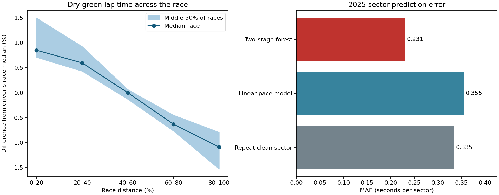

# 2025 pace and sector-prediction evidence

## Prediction experiment

The linear regression used 138,217 training sectors from 2023–24. All methods were evaluated on 70,410 sectors covering 24 races in 2025. The clean-sector persistence baseline reuses the representative previous sector time. The fitted model predicts fractional change from that anchor using three relative pace features. The forest score comes from the saved v3 evaluation in `model/v3/fforest_results.json`.

| Method | Mean absolute error (seconds per sector) |
|---|---:|
| Repeat the last representative clean sector | 0.335090 |
| Linear pace regression, newly trained | 0.355035 |
| Two-Stage Forest v3, saved evaluation | 0.2305 |

The forest reduces MAE by 0.105 s (31.2%) relative to persistence. The fitted linear model adds 0.020 s of error. Its intercept is −0.00359543. Coefficients on the relative previous duration, previous sector duration and representative median of three are 0.00720170, 0.00535564 and 0.16081639, respectively. Inputs are divided by the anchor and centered at one. Missing ratios are replaced by zero after centering.

## Lap-time trend

Sum all three valid sectors of each driver-lap. Retain green laps on dry compounds with zero recorded rainfall, excluding pit and post-pit laps. Express time as a percentage deviation from the same driver's eligible lap-time median in that race. Split by fifths of race distance, compute a median per race and bin, then weight each race equally. The analysis includes 21,186 eligible laps in the 21 races covering all five bins.

| Race distance | Median time deviation | Middle 50% of race medians |
|---|---:|---:|
| 0–20% | +0.85% | +0.71 to +1.50% |
| 20–40% | +0.60% | +0.43 to +0.93% |
| 40–60% | 0.00% | −0.13 to +0.07% |
| 60–80% | −0.63% | −0.77 to −0.45% |
| 80–100% | −1.09% | −1.53 to −0.79% |

The first-to-last difference in bin medians is 1.94 percentage points. Fuel load, tyre strategy, track evolution and the composition of drivers still running may affect this descriptive trend. The shaded band shows variation across races.

Reproduce both analyses with `python _deck_pace_evidence.py` in the project environment.
